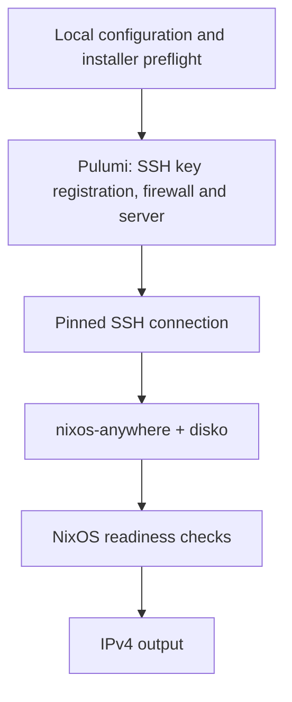

# nixos-vps

Provision a reproducible NixOS VPS on Hetzner Cloud from TypeScript.

`nixos-vps` combines Pulumi-managed infrastructure with a locked Nix flake and
`nixos-anywhere`. Its `NixosServer` component checks SSH policy, disk configuration
and installer integrity before creating cloud resources, then installs NixOS over
SSH. The IPv4 output resolves after installation and SSH readiness checks complete.

> [!NOTE]
> **Experimental / pre-release.** Local validation passes: 38 package tests,
> four VM installation checks, NixOS builds and independent tarball-consumer tests.
> Live Hetzner provisioning has not yet been validated. Use the local tarball until
> the first npm release. See [validation coverage](docs/validation.md) for details.

> [!WARNING]
> NixOS installation repartitions and formats the target server disk. Use this
> workflow for newly created or intentionally disposable servers, and review the
> generated disk configuration before deployment.

## How it works



The package includes:

- A `NixosServer` component with configurable server type, location and firewall ports.
- An initialization CLI that creates a project with separate client and server-host
  SSH identities.
- Local validation of keys, SSH policy, NixOS configuration, disk layout and
  installer integrity.
- Locked NixOS templates and a generic web-server example, with shared base and
  disk configuration checked for parity.

Configure applications in your own NixOS flake. Optional SOPS integration can
supply the operator's provisioning token.

## Get started

Use Bash on **x86_64 Linux**. Choose the setup that matches how you obtain the
package:

- **From this repository:** install Nix 2.24+ with `nix-command` and `flakes`
  enabled, download the source, and run `nix develop` from the repository root.
  The development shell provides Node.js 22/npm, Pulumi CLI, OpenSSH, Git and the
  installer tools; you do not need to install those separately. Nix itself must
  already be installed. Cloning also requires Git beforehand; downloading a
  source archive is an alternative.
- **From a package tarball in an independent project:** provide Node.js 22+/npm,
  Nix 2.24+ with flakes enabled, OpenSSH 9+, Git and Pulumi CLI v3 through your
  own environment. Installing the npm package does not create a Nix development
  shell or install these system tools.

Keep the development shell open while running commands that use its tools.
Deployment additionally requires a Hetzner Cloud project and token. The
initializer generates the SSH identities.

Follow the [quickstart](packages/nixos-vps/README.md#quickstart) for installation,
key generation, configuration, validation and deployment in order. You can finish
the local setup without Hetzner credentials or creating a server.

The [package guide](packages/nixos-vps/README.md) includes the complete API,
installation requirements and troubleshooting instructions.

## Development

With Nix flakes enabled on x86_64 Linux:

```sh
nix develop
npm ci --ignore-scripts
npm run check
npm test
```

Run the complete local suite, including NixOS VM checks:

```sh
./scripts/validate.sh
```

Tests use temporary state, test identities and local substitute providers. They do
not contact Hetzner. Dependency installation and Nix builds may download public
sources and cache objects.

## Local package

Build a tarball:

```sh
npm run pack:component
```

This creates `/tmp/nixos-vps-0.1.0.tgz`.

Both the workspace root and `packages/nixos-vps/package.json` currently set
`private: true`. npm publication is intentionally disabled during pre-release
review; local tarball installation is supported.

## Documentation

- [Quickstart and API reference](packages/nixos-vps/README.md)
- [Architecture](docs/architecture.md)
- [Validation coverage](docs/validation.md)
- [Security](SECURITY.md)
- [Contributing](CONTRIBUTING.md)

## License

[MIT](LICENSE).
